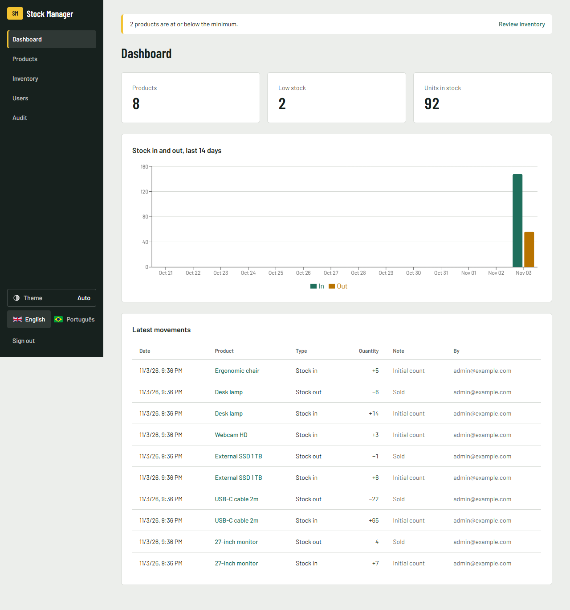
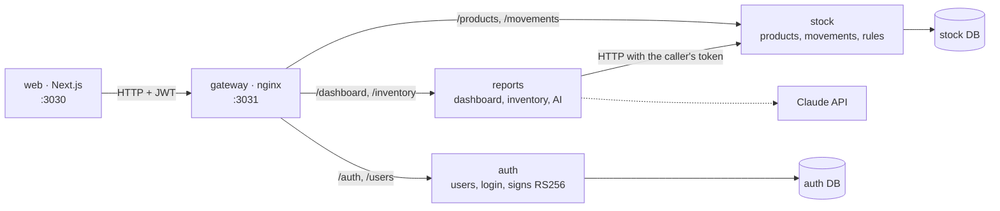
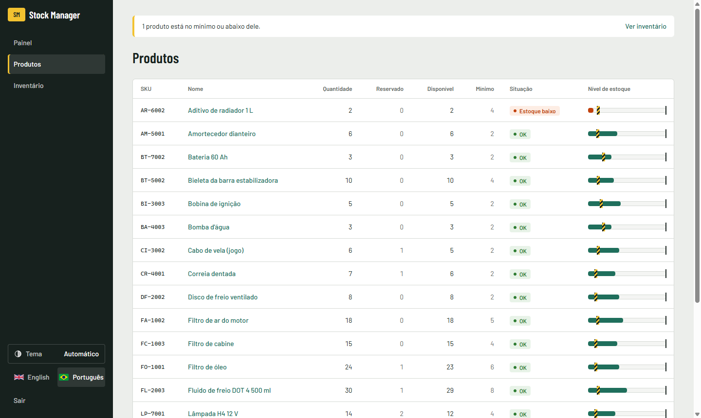

# Stock Manager

[](https://github.com/rodrigoZanardo/stock-manager/actions/workflows/ci.yml)


Inventory control app: products, stock in and out, low-stock alerts, login with roles and a dashboard.
A full-stack portfolio project, written from scratch, with the business rules in a tested domain layer.



## Run it in one command

```bash
docker compose up --build
```

| What | URL |
|---|---|
| Web app | http://localhost:3030 |
| API docs (Swagger, try requests live) | http://localhost:3032/docs (auth) · http://localhost:3033/docs (stock) · http://localhost:3034/docs (reports) |

Sign in with `admin@example.com` / `change-me-please`. `ADMIN_EMAIL` and `ADMIN_PASSWORD` set the first admin only, on the first start. Changing them later does not change an existing admin (see [.env.example](.env.example)).

<details>
<summary><b>Quick tour: what to try in 2 minutes</b></summary>

1. Sign in as admin and create a product on **Products** (SKU `KB-001`, minimum `5`). It shows **Low stock**, because it starts at 0.
2. Open it and register **Stock in** of 10. The badge turns **OK** and the dashboard chart updates.
3. Try **Stock out** of 99. The API refuses it, and the message appears in the language you chose.
4. Try to delete the product. It is refused, because it has movement history.
5. On **Users**, create an operator and sign in as them. The create, edit and delete buttons are gone, and the API also returns `403` if they are called directly.
6. Switch the language to **Português** in the header.

</details>

## Architecture



Three services behind one gateway. Each owns its data: `auth` and `stock` have their own database, `reports` has none and reads from `stock`. Only `auth` holds the private key; every service verifies tokens with the public key, so no service calls `auth` on each request.

Inside each service, dependencies point inward: `domain` imports nothing from the framework, and `application` only knows abstract ports. Shared code (error catalog, auth guard, bootstrap) lives once in `packages/shared`.

### Layers

<details>
<summary><b>domain/</b>: the business rules</summary>

Plain TypeScript classes with a private constructor. `create()` validates, `restore()` rebuilds from the database without re-validating.

- `Product`: SKU is normalized (`kb-001` → `KB-001`) and must be 3-32 letters, digits or dashes. Stock never goes negative. Quantities are whole numbers above zero. **Low stock** means quantity ≤ minimum.
- `User`: email is normalized, the password has at least 8 characters, and the role is `ADMIN` or `OPERATOR`.

```ts
move(type: MovementType, quantity: number): void {
  if (!Number.isInteger(quantity) || quantity <= 0) throw new AppError('QUANTITY_INVALID');
  if (type === 'OUT' && quantity > this.props.quantity)
    throw new AppError('NOT_ENOUGH_STOCK', { available: this.props.quantity, requested: quantity });
  this.props.quantity += type === 'IN' ? quantity : -quantity;
}
```

</details>

<details>
<summary><b>application/</b>: use cases and ports</summary>

One class per use case, each with a single `execute()`. Ports are abstract classes that also serve as DI tokens (`ProductRepository`, `UserRepository`, `PasswordHasher`, `TokenService`).

Use cases: create, list, get, update and delete products, register and list movements, the dashboard, create users, log in, and create the first admin on startup.

</details>

<details>
<summary><b>infra/</b>: database and crypto</summary>

- Prisma repositories sharing one `PrismaService` connection.
- A stock movement and its quantity change are written in **one transaction**, with a conditional `updateMany` (`quantity >= n`). Two simultaneous withdrawals cannot both pass, even if both passed the in-memory check.
- Passwords use `scrypt` from Node's `crypto` (no native dependency), compared with `timingSafeEqual`.

</details>

<details>
<summary><b>http/</b>: the REST boundary</summary>

- DTOs with `class-validator` check the shape. The entity checks the rules. Validation happens twice on purpose.
- **Error library:** every error has a stable code in one catalog (`packages/shared/src/errors.ts`). A global filter returns `{ statusCode, code, message, params }`, and the web app translates the code. A test fails if a code has no translation.

```json
{ "statusCode": 400, "code": "NOT_ENOUGH_STOCK", "params": { "available": 10, "requested": 99 },
  "message": "Not enough stock: 10 available, 99 requested." }
```

- A global `AuthGuard` requires a JWT on every route except those marked `@Public()`. `@Roles('ADMIN')` protects writes to the catalog.

| Method | Route | Role |
|---|---|---|
| POST | `/auth/login` | public |
| POST | `/users` | admin |
| GET | `/products`, `/products/:id`, `/products/:id/movements`, `/dashboard`, `/inventory` | any |
| POST | `/products/:id/movements` | any |
| POST / PATCH / DELETE | `/products`, `/products/:id` | admin |
| POST | `/inventory/analysis` (AI) | admin |
| GET | `/audit/auth`, `/audit/stock` | admin |

</details>

<details>
<summary><b>web/</b>: the Next.js app</summary>

- Server components load the data. Only the interactive parts are client components.
- All API calls go through `lib/api.ts`. The JWT lives in an **httpOnly** cookie, so browser JavaScript never sees it.
- Forms use react-hook-form + zod for instant feedback, but when the API refuses something they show its reason, translated from the error code. The rules stay in the backend.
- English and Portuguese with next-intl. Every list has loading, error and empty states. Low stock is shown as text, not color alone.



</details>

## Technical decisions

| Decision | Why |
|---|---|
| Three services, split by data ownership | `auth`, `stock` and `reports` change for different reasons. Splitting further would add network hops with no gain at this size. |
| RS256 tokens, public key in every service | A service that only verifies tokens cannot issue them, and no service needs to call `auth` per request. |
| Audit entry written in the same transaction as the change | A change can never exist without its record, and a failed write leaves no false record. |
| Rules in the entity, not the controller | They can be tested without HTTP or a database, and every entry point gets the same rules. |
| Race guard in SQL, not only in memory | Two requests can read the same stock at the same time. The database is the only place that sees both. |
| Products with history cannot be deleted | Deleting them would erase the audit trail of stock movements. |
| First admin from env vars, no open sign-up | A public demo should not let anyone create an admin. |
| Same error for wrong password and unknown email | It does not reveal which accounts exist. |
| Errors as codes, translated in the UI | The API stays language-neutral, and every error reaches the user in their language. |
| Locale in a cookie, not the URL | The app sits behind a login, so localized URLs bring no SEO benefit. |

## Development

```bash
npm install && npm test && npm run typecheck
cd web && npm install && npm run lint && npm run build
```

Tests run on every push with GitHub Actions. Rules for contributors and AI coding agents are in [AGENTS.md](AGENTS.md).

<details>
<summary><b>Run without Docker</b></summary>

1. Start PostgreSQL and copy `.env.example` to `services/<name>/.env` (one per service) and `web/.env.local`.
2. `npm install && npm run keys && npm run build`
3. `npm start` inside `services/auth`, `services/stock` and `services/reports`
4. `cd web && npm run dev`

</details>

## Roadmap

- [x] Products, movements, low stock
- [x] JWT login with admin and operator roles
- [x] Dashboard with a 14-day chart
- [x] Docker Compose, CI
- [x] Min and max stock, low-stock alert, inventory report (average out per day, suggested stock, what to buy)
- [x] AI inventory analysis with Claude (optional, admin only, the API key stays on the server)
- [x] Design system with light and dark themes ([docs/design](docs/design/DESIGN.md))
- [x] Split into microservices: auth, stock, reports
- [x] Audit trail: who changed what and when (products, stock, users, logins) and one structured log line per request
- [ ] Online demo
