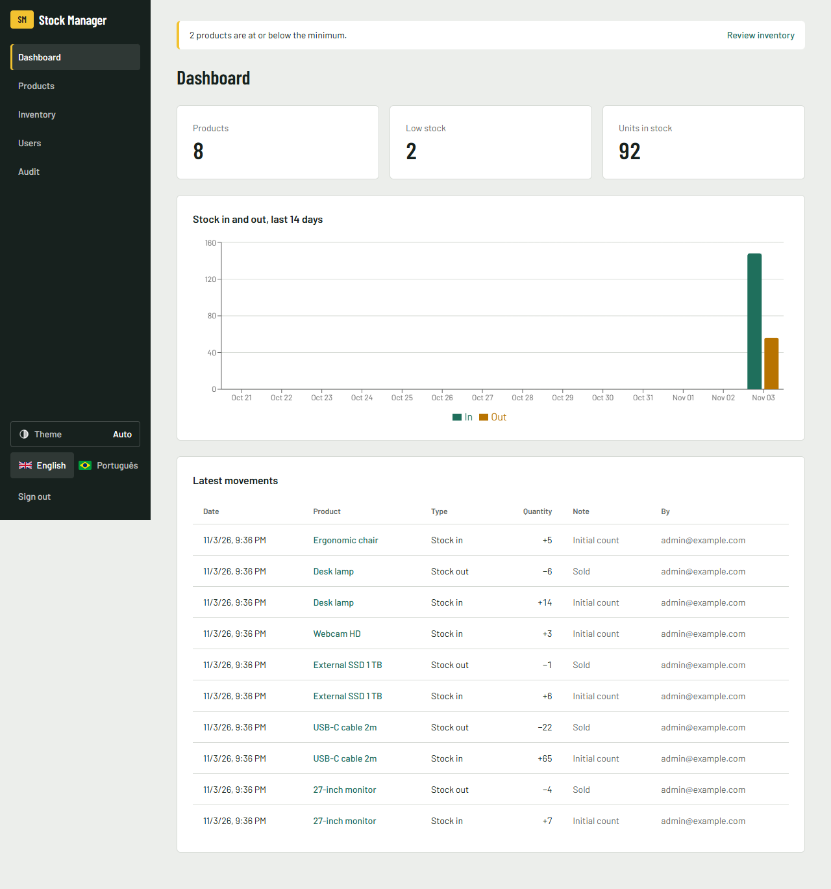
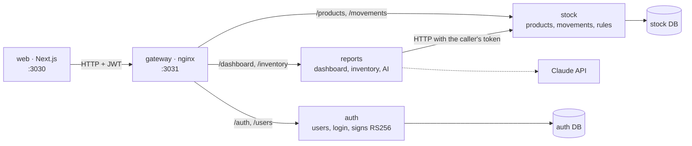
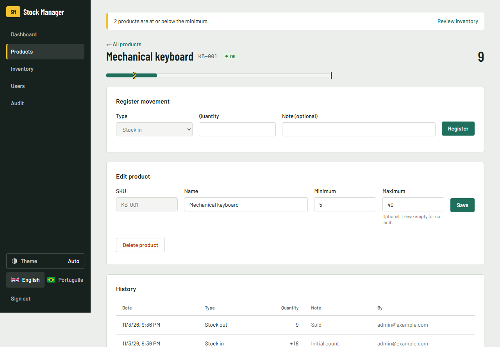

# Stock Manager

[English](../README.md) · [Português (BR)](README.pt-BR.md) · [Português (PT)](README.pt-PT.md) · **Español** · [Français](README.fr.md)

Aplicación de control de inventario con productos, entradas y salidas de stock, alertas de stock bajo, inicio de sesión con roles y un panel.
Es un proyecto full-stack de portafolio, escrito desde cero, con las reglas de negocio en una capa de dominio probada.



## Ejecutar con un comando

```bash
docker compose up --build
```

| Qué | URL |
|---|---|
| Aplicación web | http://localhost:3030 |
| Documentación de la API (Swagger, permite probar en vivo) | http://localhost:3032/docs (auth) · http://localhost:3033/docs (stock) · http://localhost:3034/docs (reports) |

Para entrar, usa `admin@example.com` / `change-me-please`. `ADMIN_EMAIL` y `ADMIN_PASSWORD` solo definen el primer administrador, en el primer inicio. Cambiarlos después no modifica un administrador que ya existe (ver el [.env.example](../.env.example)).

<details>
<summary><b>Recorrido rápido: qué probar en 2 minutos</b></summary>

1. Entra como admin y crea un producto en **Products** (SKU `KB-001`, mínimo `5`). Aparece como **Low stock**, porque empieza en 0.
2. Ábrelo y registra una **entrada** de 10. La etiqueta pasa a **OK** y el gráfico del panel se actualiza.
3. Prueba una **salida** de 99. La API la rechaza, y el mensaje aparece en el idioma que elegiste.
4. Intenta eliminar el producto. Se rechaza, porque tiene historial de movimientos.
5. En **Users**, crea un operador y entra con él. Desaparecen los botones de crear, editar y eliminar, y la API también devuelve `403` si se llaman directamente.
6. Cambia el idioma en la parte superior de la página.

La interfaz está disponible en inglés y en portugués.

</details>

## Arquitectura



Tres servicios detrás de un único gateway. Cada uno es dueño de sus datos: `auth` y `stock` tienen su propia base de datos, y `reports` no tiene ninguna, lee de `stock`. Solo `auth` tiene la clave privada; los servicios verifican el token con la clave pública, así que ninguno llama a `auth` en cada petición.

Dentro de cada servicio, las dependencias apuntan hacia dentro: `domain` no importa nada del framework, y `application` solo conoce puertos abstractos. El código común (catálogo de errores, guard de autenticación, arranque) está una sola vez en `packages/shared`.

### Capas

<details>
<summary><b>domain/</b>: las reglas de negocio</summary>

Son clases TypeScript simples con constructor privado. `create()` valida los datos, y `restore()` reconstruye el objeto desde la base de datos sin volver a validar.

- `Product`: el SKU se normaliza (`kb-001` → `KB-001`) y debe tener entre 3 y 32 letras, dígitos o guiones. El stock nunca queda negativo. Las cantidades son números enteros mayores que cero. **Stock bajo** significa cantidad ≤ mínimo.
- `User`: el correo se normaliza, la contraseña tiene al menos 8 caracteres, y el rol es `ADMIN` u `OPERATOR`.

```ts
move(type: MovementType, quantity: number): void {
  if (!Number.isInteger(quantity) || quantity <= 0) throw new AppError('QUANTITY_INVALID');
  if (type === 'OUT' && quantity > this.props.quantity)
    throw new AppError('NOT_ENOUGH_STOCK', { available: this.props.quantity, requested: quantity });
  this.props.quantity += type === 'IN' ? quantity : -quantity;
}
```

</details>

<details>
<summary><b>application/</b>: casos de uso y puertos</summary>

Cada caso de uso es una clase con un único `execute()`. Los puertos son clases abstractas que también sirven como token de inyección de dependencias (`ProductRepository`, `UserRepository`, `PasswordHasher`, `TokenService`).

Casos de uso: crear, listar, consultar, editar y eliminar productos, registrar y listar movimientos, el panel, crear usuarios, iniciar sesión y crear el primer admin al arrancar.

</details>

<details>
<summary><b>infra/</b>: base de datos y criptografía</summary>

- Los repositorios Prisma comparten una única conexión, `PrismaService`.
- Un movimiento y el cambio de cantidad se guardan **en una sola transacción**, con un `updateMany` condicional (`quantity >= n`). Dos salidas simultáneas no pueden pasar las dos, aunque ambas hayan pasado la comprobación en memoria.
- Las contraseñas usan `scrypt` del módulo `crypto` de Node (sin dependencia nativa) y se comparan con `timingSafeEqual`.

</details>

<details>
<summary><b>http/</b>: la frontera REST</summary>

- Los DTOs con `class-validator` comprueban el formato, y la entidad comprueba las reglas. La validación ocurre dos veces, a propósito.
- **Biblioteca de errores:** cada error tiene un código estable, todos en un único catálogo (`packages/shared/src/errors.ts`). Un filtro global devuelve `{ statusCode, code, message, params }`, y la aplicación web traduce el código. Una prueba falla si algún código no tiene traducción.

```json
{ "statusCode": 400, "code": "NOT_ENOUGH_STOCK", "params": { "available": 10, "requested": 99 },
  "message": "Not enough stock: 10 available, 99 requested." }
```

- Un `AuthGuard` global exige JWT en todas las rutas, salvo en las marcadas con `@Public()`. `@Roles('ADMIN')` protege los cambios en el catálogo.

| Método | Ruta | Rol |
|---|---|---|
| POST | `/auth/login` | público |
| POST | `/users` | admin |
| GET | `/products`, `/products/:id`, `/products/:id/movements`, `/dashboard`, `/inventory` | cualquiera |
| POST | `/products/:id/movements` | cualquiera |
| POST / PATCH / DELETE | `/products`, `/products/:id` | admin |
| POST | `/inventory/analysis` (AI) | admin |
| GET | `/audit/auth`, `/audit/stock` | admin |

</details>

<details>
<summary><b>web/</b>: la aplicación Next.js</summary>

- Los server components cargan los datos. Solo las partes interactivas son client components.
- Todas las llamadas a la API pasan por `lib/api.ts`. El JWT vive en una cookie **httpOnly**, así que el JavaScript del navegador nunca lo ve.
- Los formularios usan react-hook-form + zod para dar respuesta inmediata. Cuando la API rechaza algo, muestran el motivo traducido a partir del código de error. Las reglas siguen en el back-end.
- Inglés y portugués con next-intl. Todas las listas tienen estados de carga, error y vacío. El stock bajo se muestra con texto, no solo con color.



</details>

## Decisiones técnicas

| Decisión | Por qué |
|---|---|
| Tres servicios, divididos por dueño de los datos | `auth`, `stock` y `reports` cambian por motivos distintos. Dividir más solo añadiría llamadas de red, sin ganancia a este tamaño. |
| Tokens RS256, clave pública en cada servicio | Un servicio que solo verifica el token no puede emitir uno, y ningún servicio necesita llamar a `auth` en cada petición. |
| Registro de auditoría escrito en la misma transacción que el cambio | Nunca existe un cambio sin registro, y una escritura fallida no deja un registro falso. |
| Reglas en la entidad, no en el controller | Se pueden probar sin HTTP ni base de datos, y todos los puntos de entrada siguen las mismas reglas. |
| Protección contra concurrencia en SQL, no solo en memoria | Dos peticiones pueden leer el mismo stock a la vez. La base de datos es el único lugar que ve ambas. |
| Un producto con historial no se puede eliminar | Borrarlo eliminaría el registro de los movimientos de stock. |
| Primer admin por variables de entorno, sin registro abierto | Una demo pública no debe permitir que cualquiera cree un admin. |
| El mismo error para contraseña incorrecta y correo inexistente | Así no se revela qué cuentas existen. |
| Errores como códigos, traducidos en la interfaz | La API no depende del idioma, y cada error llega al usuario en su idioma. |
| Idioma en una cookie, no en la URL | La aplicación está detrás de un inicio de sesión, así que las URLs por idioma no aportan SEO. |

## Desarrollo

```bash
npm install && npm test && npm run typecheck
cd web && npm install && npm run lint && npm run build
```

Las pruebas se ejecutan en cada push con GitHub Actions. Las reglas para quien contribuya y para agentes de IA están en [AGENTS.md](../AGENTS.md).

<details>
<summary><b>Ejecutar sin Docker</b></summary>

1. Arranca un PostgreSQL y copia `.env.example` a `services/<nombre>/.env` (uno por servicio) y `web/.env.local`.
2. `npm install && npm run keys && npm run build`
3. `npm start` dentro de `services/auth`, `services/stock` y `services/reports`
4. `cd web && npm run dev`

</details>

## Próximos pasos

- [x] Productos, movimientos, stock bajo
- [x] Inicio de sesión con JWT y roles admin y operador
- [x] Panel con gráfico de 14 días
- [x] Docker Compose, CI
- [x] Stock mínimo y máximo, alerta de stock bajo, informe de inventario (media de salida por día, stock sugerido, qué comprar)
- [x] Análisis del inventario con IA (Claude; opcional, solo admin, la clave de la API queda en el servidor)
- [x] Design system con tema claro y oscuro ([docs/design](design/DESIGN.md))
- [x] Separar en microservicios: auth, stock, informes
- [x] Auditoría: quién cambió qué y cuándo (productos, stock, usuarios, inicios de sesión) y una línea de log estructurado por petición
- [ ] Demo en línea
