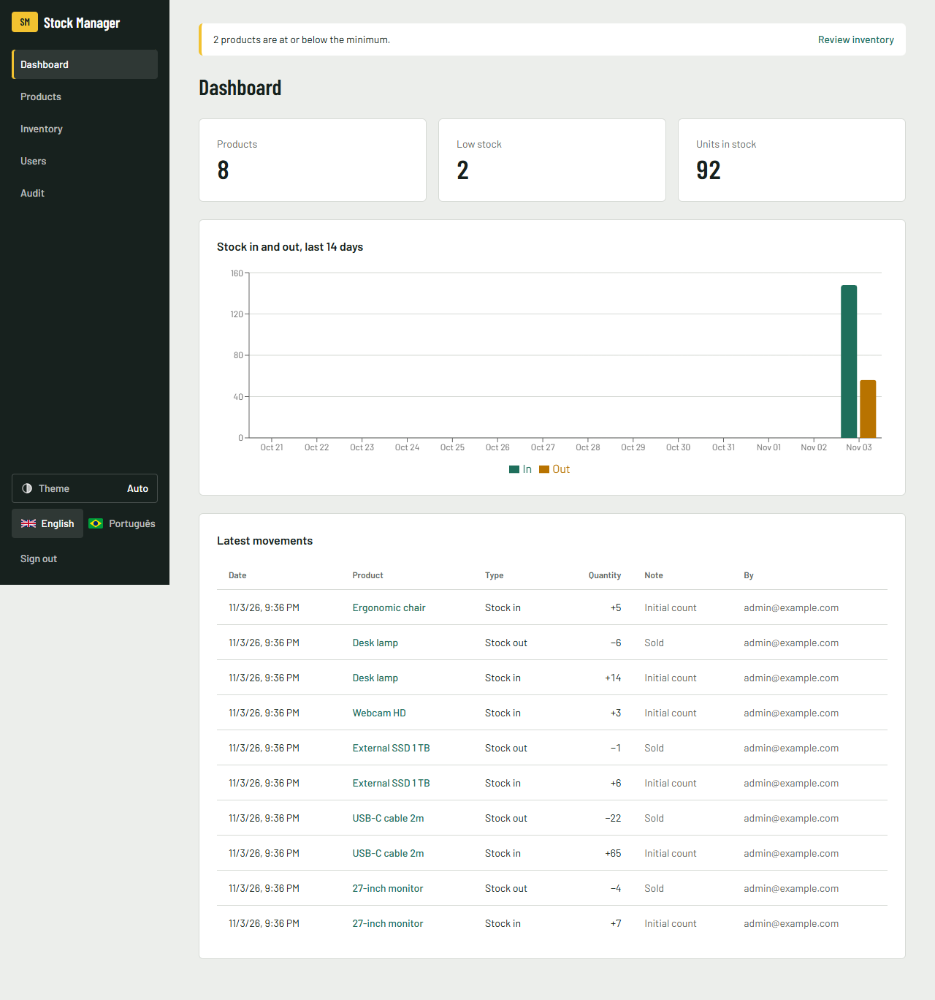
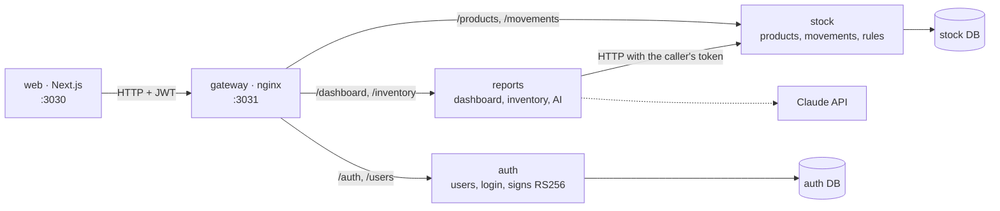
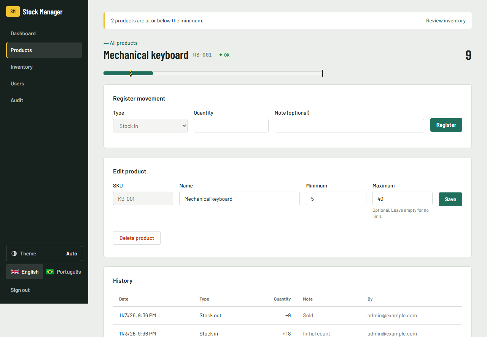

# Stock Manager

[English](../README.md) · [Português (BR)](README.pt-BR.md) · [Português (PT)](README.pt-PT.md) · [Español](README.es.md) · **Français**

Application de gestion de stock : produits, entrées et sorties, alertes de stock bas, connexion avec rôles et tableau de bord.
C'est un projet full-stack de portfolio, écrit de zéro, avec les règles métier dans une couche domaine testée.



## Lancer en une commande

```bash
docker compose up --build
```

| Quoi | URL |
|---|---|
| Application web | http://localhost:3030 |
| Documentation de l'API (Swagger, requêtes testables en direct) | http://localhost:3032/docs (auth) · http://localhost:3033/docs (stock) · http://localhost:3034/docs (reports) |

Pour vous connecter, utilisez `admin@example.com` / `change-me-please`. `ADMIN_EMAIL` et `ADMIN_PASSWORD` ne définissent que le premier administrateur, au premier démarrage. Les modifier ensuite ne change pas un administrateur existant (voir le [.env.example](../.env.example)).

<details>
<summary><b>Visite rapide : quoi tester en 2 minutes</b></summary>

1. Connectez-vous en admin et créez un produit dans **Products** (SKU `KB-001`, minimum `5`). Il apparaît en **Low stock**, car il démarre à 0.
2. Ouvrez-le et enregistrez une **entrée** de 10. Le badge passe à **OK** et le graphique du tableau de bord se met à jour.
3. Essayez une **sortie** de 99. L'API la refuse, et le message s'affiche dans la langue choisie.
4. Essayez de supprimer le produit. La suppression est refusée, car le produit a un historique de mouvements.
5. Dans **Users**, créez un opérateur et connectez-vous avec. Les boutons de création, de modification et de suppression disparaissent, et l'API renvoie aussi `403` s'ils sont appelés directement.
6. Changez la langue en haut de la page.

L'interface est disponible en anglais et en portugais.

</details>

## Architecture



Trois services derrière une seule passerelle. Chacun possède ses données : `auth` et `stock` ont leur propre base, et `reports` n'en a pas, il lit depuis `stock`. Seul `auth` détient la clé privée ; les services vérifient le token avec la clé publique, donc aucun n'appelle `auth` à chaque requête.

Dans chaque service, les dépendances pointent vers l'intérieur : `domain` n'importe rien du framework, et `application` ne connaît que des ports abstraits. Le code commun (catalogue d’erreurs, guard d’authentification, démarrage) existe une seule fois dans `packages/shared`.

### Couches

<details>
<summary><b>domain/</b> : les règles métier</summary>

Ce sont des classes TypeScript simples, avec un constructeur privé. `create()` valide les données, et `restore()` reconstruit l'objet depuis la base sans revalider.

- `Product` : le SKU est normalisé (`kb-001` → `KB-001`) et doit contenir de 3 à 32 lettres, chiffres ou tirets. Le stock n'est jamais négatif. Les quantités sont des entiers supérieurs à zéro. **Stock bas** signifie quantité ≤ minimum.
- `User` : l'e-mail est normalisé, le mot de passe compte au moins 8 caractères, et le rôle est `ADMIN` ou `OPERATOR`.

```ts
move(type: MovementType, quantity: number): void {
  if (!Number.isInteger(quantity) || quantity <= 0) throw new AppError('QUANTITY_INVALID');
  if (type === 'OUT' && quantity > this.props.quantity)
    throw new AppError('NOT_ENOUGH_STOCK', { available: this.props.quantity, requested: quantity });
  this.props.quantity += type === 'IN' ? quantity : -quantity;
}
```

</details>

<details>
<summary><b>application/</b> : cas d'usage et ports</summary>

Chaque cas d'usage est une classe avec une seule méthode `execute()`. Les ports sont des classes abstraites qui servent aussi de jetons d'injection (`ProductRepository`, `UserRepository`, `PasswordHasher`, `TokenService`).

Cas d'usage : créer, lister, consulter, modifier et supprimer des produits, enregistrer et lister des mouvements, le tableau de bord, créer des utilisateurs, se connecter et créer le premier admin au démarrage.

</details>

<details>
<summary><b>infra/</b> : base de données et cryptographie</summary>

- Les dépôts Prisma partagent une seule connexion, `PrismaService`.
- Un mouvement et la variation de quantité sont écrits **dans une seule transaction**, avec un `updateMany` conditionnel (`quantity >= n`). Deux sorties simultanées ne peuvent pas passer toutes les deux, même si elles ont toutes deux passé la vérification en mémoire.
- Les mots de passe utilisent `scrypt` du module `crypto` de Node (sans dépendance native) et sont comparés avec `timingSafeEqual`.

</details>

<details>
<summary><b>http/</b> : la frontière REST</summary>

- Les DTOs avec `class-validator` vérifient le format, et l'entité vérifie les règles. La validation a lieu deux fois, volontairement.
- **Bibliothèque d'erreurs :** chaque erreur a un code stable, tous dans un catalogue unique (`packages/shared/src/errors.ts`). Un filtre global renvoie `{ statusCode, code, message, params }`, et l'application web traduit le code. Un test échoue si un code n'a pas de traduction.

```json
{ "statusCode": 400, "code": "NOT_ENOUGH_STOCK", "params": { "available": 10, "requested": 99 },
  "message": "Not enough stock: 10 available, 99 requested." }
```

- Un `AuthGuard` global exige un JWT sur toutes les routes, sauf celles marquées `@Public()`. `@Roles('ADMIN')` protège les modifications du catalogue.

| Méthode | Route | Rôle |
|---|---|---|
| POST | `/auth/login` | public |
| POST | `/users` | admin |
| GET | `/products`, `/products/:id`, `/products/:id/movements`, `/dashboard`, `/inventory` | tous |
| POST | `/products/:id/movements` | tous |
| POST / PATCH / DELETE | `/products`, `/products/:id` | admin |
| POST | `/inventory/analysis` (AI) | admin |
| GET | `/audit/auth`, `/audit/stock` | admin |

</details>

<details>
<summary><b>web/</b> : l'application Next.js</summary>

- Les server components chargent les données. Seules les parties interactives sont des client components.
- Tous les appels à l'API passent par `lib/api.ts`. Le JWT est stocké dans un cookie **httpOnly**, donc le JavaScript du navigateur n'y a jamais accès.
- Les formulaires utilisent react-hook-form + zod pour un retour immédiat. Quand l'API refuse une action, ils affichent la raison, traduite à partir du code d'erreur. Les règles restent dans le back-end.
- Anglais et portugais avec next-intl. Chaque liste a des états de chargement, d'erreur et vide. Le stock bas est indiqué par un texte, pas seulement par une couleur.



</details>

## Choix techniques

| Choix | Pourquoi |
|---|---|
| Trois services, découpés par propriétaire des données | `auth`, `stock` et `reports` changent pour des raisons différentes. Découper davantage n'ajouterait que des appels réseau, sans gain à cette taille. |
| Tokens RS256, clé publique dans chaque service | Un service qui ne fait que vérifier un token ne peut pas en émettre, et aucun service n'a besoin d'appeler `auth` à chaque requête. |
| Entrée d'audit écrite dans la même transaction que la modification | Aucune modification n'existe sans sa trace, et une écriture échouée ne laisse pas de fausse trace. |
| Règles dans l'entité, pas dans le controller | Elles se testent sans HTTP ni base de données, et tous les points d'entrée suivent les mêmes règles. |
| Protection contre la concurrence en SQL, pas seulement en mémoire | Deux requêtes peuvent lire le même stock en même temps. La base de données est le seul endroit qui voit les deux. |
| Un produit avec historique ne peut pas être supprimé | Le supprimer effacerait la trace des mouvements de stock. |
| Premier admin par variables d'environnement, sans inscription ouverte | Une démo publique ne doit pas laisser n'importe qui créer un admin. |
| La même erreur pour un mauvais mot de passe et un e-mail inconnu | Cela ne révèle pas quels comptes existent. |
| Erreurs sous forme de codes, traduites dans l'interface | L'API ne dépend d'aucune langue, et chaque erreur arrive à l'utilisateur dans sa langue. |
| Langue dans un cookie, pas dans l'URL | L'application est derrière une connexion, donc des URL par langue n'apportent rien au SEO. |

## Développement

```bash
npm install && npm test && npm run typecheck
cd web && npm install && npm run lint && npm run build
```

Les tests s'exécutent à chaque push avec GitHub Actions. Les règles pour les contributeurs et les agents IA sont dans [AGENTS.md](../AGENTS.md).

<details>
<summary><b>Lancer sans Docker</b></summary>

1. Démarrez un PostgreSQL et copiez `.env.example` vers `services/<nom>/.env` (un par service) et `web/.env.local`.
2. `npm install && npm run keys && npm run build`
3. `npm start` dans `services/auth`, `services/stock` et `services/reports`
4. `cd web && npm run dev`

</details>

## Feuille de route

- [x] Produits, mouvements, stock bas
- [x] Connexion JWT avec rôles admin et opérateur
- [x] Tableau de bord avec graphique sur 14 jours
- [x] Docker Compose, CI
- [x] Stock minimum et maximum, alerte de stock bas, rapport d'inventaire (sortie moyenne par jour, stock conseillé, quoi acheter)
- [x] Analyse de l'inventaire par IA (Claude ; optionnelle, admin uniquement, la clé d'API reste sur le serveur)
- [x] Design system avec thèmes clair et sombre ([docs/design](design/DESIGN.md))
- [x] Découper en microservices : auth, stock, rapports
- [x] Journal d'audit : qui a changé quoi et quand (produits, stock, utilisateurs, connexions) et une ligne de log structuré par requête
- [ ] Démo en ligne
