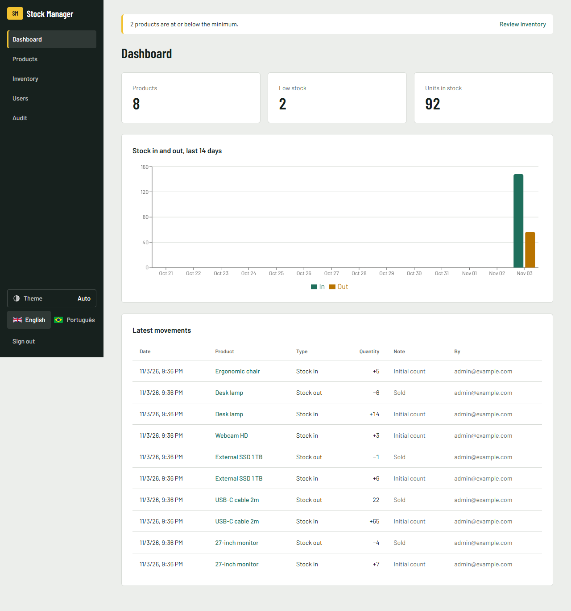
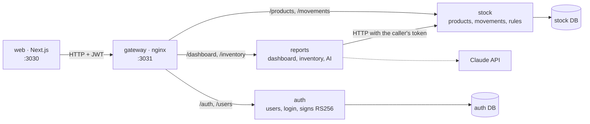
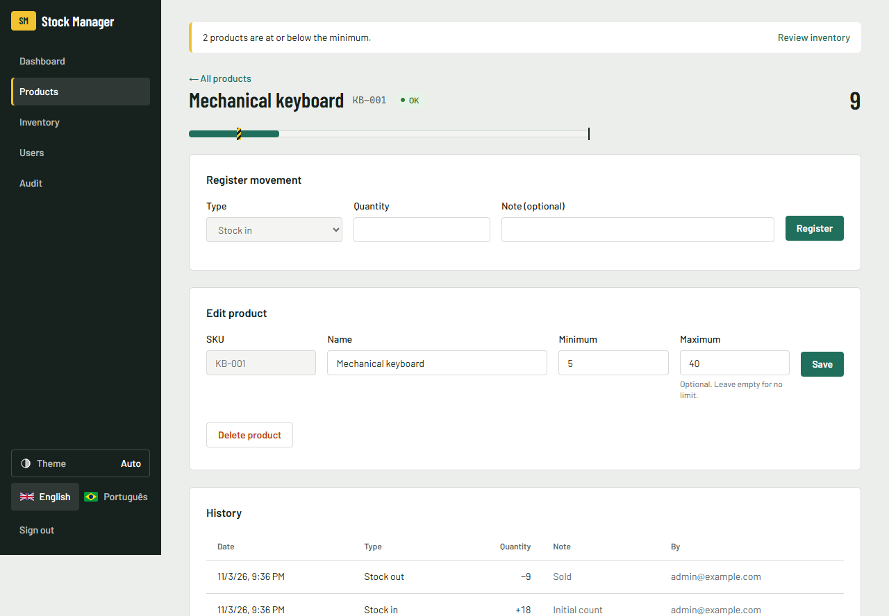

# Stock Manager

[English](../README.md) · **Português (BR)** · [Português (PT)](README.pt-PT.md) · [Español](README.es.md) · [Français](README.fr.md)

Sistema de controle de estoque com produtos, entradas e saídas, alerta de estoque baixo, login com perfis e um dashboard.
É um projeto full-stack de portfólio, escrito do zero, com as regras de negócio numa camada de domínio testada.



## Rodar com um comando

```bash
docker compose up --build
```

| O quê | URL |
|---|---|
| Aplicação web | http://localhost:3030 |
| Documentação da API (Swagger, dá para testar ao vivo) | http://localhost:3032/docs (auth) · http://localhost:3033/docs (stock) · http://localhost:3034/docs (reports) |

Para entrar, use `admin@example.com` / `change-me-please`. `ADMIN_EMAIL` e `ADMIN_PASSWORD` definem só o primeiro admin, no primeiro início. Mudá-los depois não altera um admin que já existe (veja o [.env.example](../.env.example)).

<details>
<summary><b>Tour rápido: o que testar em 2 minutos</b></summary>

1. Entre como admin e cadastre um produto em **Produtos** (SKU `KB-001`, mínimo `5`). Ele aparece com **Estoque baixo**, porque começa com 0.
2. Abra o produto e registre uma **Entrada** de 10. O selo muda para **OK** e o gráfico do dashboard é atualizado.
3. Tente uma **Saída** de 99. A API recusa, e a mensagem aparece no idioma que você escolheu.
4. Tente excluir o produto. A exclusão é recusada, porque o produto tem histórico de movimentações.
5. Em **Usuários**, crie um operador e entre com ele. Os botões de criar, editar e excluir somem, e a API também devolve `403` se eles forem chamados direto.
6. Troque o idioma para **English** no topo da página.

</details>

## Arquitetura



Três serviços atrás de um único gateway. Cada um é dono dos seus dados: `auth` e `stock` têm banco próprio, e o `reports` não tem banco, ele lê do `stock`. Só o `auth` tem a chave privada; os serviços conferem o token com a chave pública, então nenhum deles chama o `auth` a cada requisição.

Dentro de cada serviço, as dependências apontam para dentro: o `domain` não importa nada do framework, e o `application` só conhece portas abstratas. O código comum (catálogo de erros, guard de autenticação, inicialização) fica uma vez só em `packages/shared`.

### Camadas

<details>
<summary><b>domain/</b>: as regras de negócio</summary>

São classes TypeScript puras, com construtor privado. O `create()` valida os dados, e o `restore()` reconstrói o objeto a partir do banco sem validar de novo.

- `Product`: o SKU é padronizado (`kb-001` → `KB-001`) e deve ter de 3 a 32 letras, números ou hífens. O estoque nunca fica negativo. As quantidades são números inteiros maiores que zero. **Estoque baixo** quer dizer quantidade ≤ mínimo.
- `User`: o e-mail é padronizado, a senha tem pelo menos 8 caracteres, e o perfil é `ADMIN` ou `OPERATOR`.

```ts
move(type: MovementType, quantity: number): void {
  if (!Number.isInteger(quantity) || quantity <= 0) throw new AppError('QUANTITY_INVALID');
  if (type === 'OUT' && quantity > this.props.quantity)
    throw new AppError('NOT_ENOUGH_STOCK', { available: this.props.quantity, requested: quantity });
  this.props.quantity += type === 'IN' ? quantity : -quantity;
}
```

</details>

<details>
<summary><b>application/</b>: casos de uso e portas</summary>

Cada caso de uso é uma classe com um único `execute()`. As portas são classes abstratas que também servem de token de injeção de dependência (`ProductRepository`, `UserRepository`, `PasswordHasher`, `TokenService`).

Casos de uso: criar, listar, buscar, editar e excluir produtos, registrar e listar movimentações, o dashboard, criar usuários, fazer login e criar o primeiro admin quando a API sobe.

</details>

<details>
<summary><b>infra/</b>: banco de dados e criptografia</summary>

- Os repositórios Prisma compartilham uma única conexão, o `PrismaService`.
- Uma movimentação e a mudança de quantidade são gravadas **numa única transação**, com um `updateMany` condicional (`quantity >= n`). Duas saídas ao mesmo tempo não passam juntas, mesmo que as duas tenham passado pela checagem em memória.
- As senhas usam `scrypt` do `crypto` do Node (sem dependência nativa) e são comparadas com `timingSafeEqual`.

</details>

<details>
<summary><b>http/</b>: a fronteira REST</summary>

- Os DTOs com `class-validator` conferem o formato dos dados, e a entidade confere as regras. A validação acontece duas vezes, de propósito.
- **Biblioteca de erros:** cada erro tem um código fixo, todos num único catálogo (`packages/shared/src/errors.ts`). Um filtro global devolve `{ statusCode, code, message, params }`, e o front traduz o código. Um teste falha se algum código ficar sem tradução.

```json
{ "statusCode": 400, "code": "NOT_ENOUGH_STOCK", "params": { "available": 10, "requested": 99 },
  "message": "Not enough stock: 10 available, 99 requested." }
```

- Um `AuthGuard` global exige JWT em todas as rotas, menos nas marcadas com `@Public()`. O `@Roles('ADMIN')` protege as alterações no catálogo.

| Método | Rota | Perfil |
|---|---|---|
| POST | `/auth/login` | público |
| POST | `/users` | admin |
| GET | `/products`, `/products/:id`, `/products/:id/movements`, `/dashboard`, `/inventory` | qualquer um |
| POST | `/products/:id/movements` | qualquer um |
| POST / PATCH / DELETE | `/products`, `/products/:id` | admin |
| POST | `/inventory/analysis` (AI) | admin |
| GET | `/audit/auth`, `/audit/stock` | admin |

</details>

<details>
<summary><b>web/</b>: a aplicação Next.js</summary>

- Os server components carregam os dados. Só as partes interativas são client components.
- Todas as chamadas à API passam pelo `lib/api.ts`. O JWT fica num cookie **httpOnly**, então o JavaScript do navegador nunca tem acesso a ele.
- Os formulários usam react-hook-form + zod para dar retorno na hora. Quando a API recusa algo, eles mostram o motivo traduzido a partir do código do erro. As regras continuam no back-end.
- Inglês e português com next-intl. Toda lista tem estado de carregando, de erro e de vazio. O estoque baixo aparece em texto, e não só pela cor.



</details>

## Decisões técnicas

| Decisão | Por quê |
|---|---|
| Três serviços, divididos por dono dos dados | `auth`, `stock` e `reports` mudam por motivos diferentes. Dividir mais só traria mais chamadas de rede, sem ganho neste tamanho. |
| Token RS256, chave pública em cada serviço | Um serviço que só confere o token não consegue emitir um, e nenhum serviço precisa chamar o `auth` a cada requisição. |
| Registro de auditoria gravado na mesma transação da mudança | Nunca existe mudança sem registro, e uma gravação que falha não deixa registro falso. |
| Regras na entidade, e não no controller | Dá para testar sem HTTP e sem banco, e toda porta de entrada segue as mesmas regras. |
| Proteção contra concorrência no SQL, e não só em memória | Duas requisições podem ler o mesmo estoque ao mesmo tempo. O banco é o único lugar que enxerga as duas. |
| Produto com histórico não pode ser excluído | A exclusão apagaria o registro das movimentações de estoque. |
| Primeiro admin por variável de ambiente, sem cadastro aberto | Uma demo pública não pode deixar qualquer pessoa criar um admin. |
| Mesmo erro para senha errada e e-mail inexistente | Assim o sistema não revela quais contas existem. |
| Erros como códigos, traduzidos na interface | A API não depende de idioma, e todo erro chega ao usuário no idioma dele. |
| Idioma num cookie, e não na URL | O sistema fica atrás de login, então URLs por idioma não trazem ganho de SEO. |

## Desenvolvimento

```bash
npm install && npm test && npm run typecheck
cd web && npm install && npm run lint && npm run build
```

Os testes rodam a cada push no GitHub Actions. As regras para quem contribui e para agentes de IA estão no [AGENTS.md](../AGENTS.md).

<details>
<summary><b>Rodar sem Docker</b></summary>

1. Suba um PostgreSQL e copie o `.env.example` para `services/<nome>/.env` (um por serviço) e `web/.env.local`.
2. `npm install && npm run keys && npm run build`
3. `npm start` dentro de `services/auth`, `services/stock` e `services/reports`
4. `cd web && npm run dev`

</details>

## Próximos passos

- [x] Produtos, movimentações, estoque baixo
- [x] Login com JWT e perfis admin e operador
- [x] Dashboard com gráfico de 14 dias
- [x] Docker Compose, CI
- [x] Estoque mínimo e máximo, alerta de estoque baixo, relatório de inventário (média de saída por dia, estoque sugerido, o que comprar)
- [x] Análise do inventário com IA (Claude; opcional, só admin, a chave da API fica no servidor)
- [x] Design system com tema claro e escuro ([docs/design](design/DESIGN.md))
- [x] Separar em microsserviços: auth, estoque, relatórios
- [x] Auditoria: quem mudou o quê e quando (produtos, estoque, usuários, logins) e uma linha de log estruturado por requisição
- [ ] Demo online
