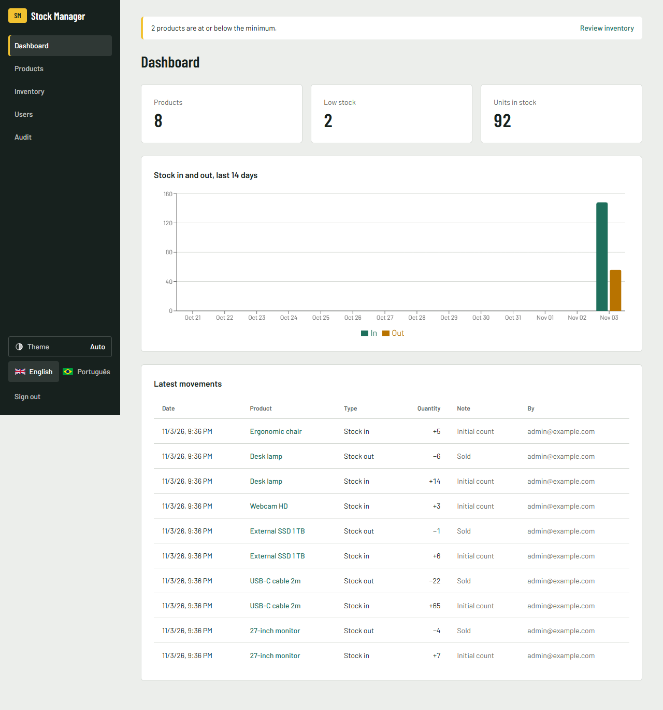
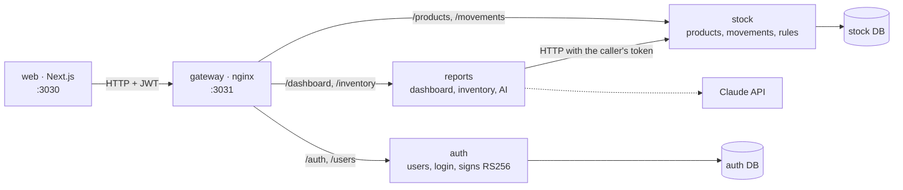
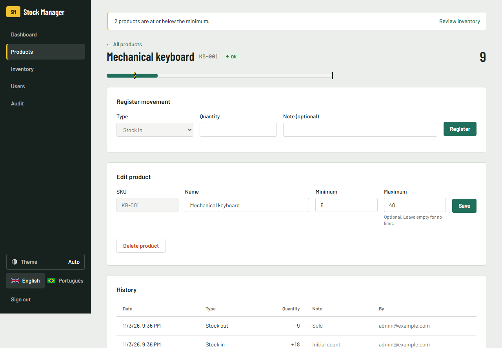

# Stock Manager

[English](../README.md) · [Português (BR)](README.pt-BR.md) · **Português (PT)** · [Español](README.es.md) · [Français](README.fr.md)

Aplicação de gestão de stock com produtos, entradas e saídas, alertas de stock baixo, autenticação com perfis e um painel.
É um projeto full-stack de portefólio, escrito de raiz, com as regras de negócio numa camada de domínio testada.



## Executar com um comando

```bash
docker compose up --build
```

| O quê | URL |
|---|---|
| Aplicação web | http://localhost:3030 |
| Documentação da API (Swagger, permite testar em direto) | http://localhost:3032/docs (auth) · http://localhost:3033/docs (stock) · http://localhost:3034/docs (reports) |

Para iniciar sessão, use `admin@example.com` / `change-me-please`. `ADMIN_EMAIL` e `ADMIN_PASSWORD` definem apenas o primeiro administrador, no primeiro arranque. Alterá-los depois não muda um administrador que já existe (ver o [.env.example](../.env.example)).

<details>
<summary><b>Visita rápida: o que experimentar em 2 minutos</b></summary>

1. Inicie sessão como admin e crie um produto em **Produtos** (SKU `KB-001`, mínimo `5`). Aparece como **Stock baixo**, porque começa a 0.
2. Abra o produto e registe uma **Entrada** de 10. O indicador passa a **OK** e o gráfico do painel é atualizado.
3. Experimente uma **Saída** de 99. A API recusa-a, e a mensagem aparece no idioma que escolheu.
4. Tente eliminar o produto. A operação é recusada, porque o produto tem histórico de movimentos.
5. Em **Utilizadores**, crie um operador e inicie sessão com ele. Os botões de criar, editar e eliminar desaparecem, e a API também devolve `403` se forem chamados diretamente.
6. Mude o idioma para **English** no topo da página.

</details>

## Arquitetura



Três serviços atrás de um único gateway. Cada um é dono dos seus dados: `auth` e `stock` têm base de dados própria, e o `reports` não tem nenhuma, lê do `stock`. Só o `auth` tem a chave privada; os serviços verificam o token com a chave pública, por isso nenhum deles chama o `auth` a cada pedido.

Dentro de cada serviço, as dependências apontam para dentro: o `domain` não importa nada da framework, e o `application` só conhece portas abstratas. O código comum (catálogo de erros, guard de autenticação, arranque) existe uma única vez em `packages/shared`.

### Camadas

<details>
<summary><b>domain/</b>: as regras de negócio</summary>

São classes TypeScript simples, com construtor privado. O `create()` valida os dados, e o `restore()` reconstrói o objeto a partir da base de dados sem voltar a validar.

- `Product`: o SKU é normalizado (`kb-001` → `KB-001`) e tem de ter entre 3 e 32 letras, algarismos ou hífenes. O stock nunca fica negativo. As quantidades são números inteiros superiores a zero. **Stock baixo** significa quantidade ≤ mínimo.
- `User`: o e-mail é normalizado, a palavra-passe tem pelo menos 8 caracteres, e o perfil é `ADMIN` ou `OPERATOR`.

```ts
move(type: MovementType, quantity: number): void {
  if (!Number.isInteger(quantity) || quantity <= 0) throw new AppError('QUANTITY_INVALID');
  if (type === 'OUT' && quantity > this.props.quantity)
    throw new AppError('NOT_ENOUGH_STOCK', { available: this.props.quantity, requested: quantity });
  this.props.quantity += type === 'IN' ? quantity : -quantity;
}
```

</details>

<details>
<summary><b>application/</b>: casos de uso e portas</summary>

Cada caso de uso é uma classe com um único `execute()`. As portas são classes abstratas que também servem de token de injeção de dependências (`ProductRepository`, `UserRepository`, `PasswordHasher`, `TokenService`).

Casos de uso: criar, listar, consultar, editar e eliminar produtos, registar e listar movimentos, o painel, criar utilizadores, iniciar sessão e criar o primeiro admin no arranque.

</details>

<details>
<summary><b>infra/</b>: base de dados e criptografia</summary>

- Os repositórios Prisma partilham uma única ligação, o `PrismaService`.
- Um movimento e a alteração de quantidade são gravados **numa única transação**, com um `updateMany` condicional (`quantity >= n`). Duas saídas em simultâneo não passam as duas, mesmo que ambas tenham passado a verificação em memória.
- As palavras-passe usam `scrypt` do `crypto` do Node (sem dependência nativa) e são comparadas com `timingSafeEqual`.

</details>

<details>
<summary><b>http/</b>: a fronteira REST</summary>

- Os DTOs com `class-validator` verificam o formato dos dados, e a entidade verifica as regras. A validação acontece duas vezes, de propósito.
- **Biblioteca de erros:** cada erro tem um código estável, todos num único catálogo (`packages/shared/src/errors.ts`). Um filtro global devolve `{ statusCode, code, message, params }`, e a aplicação web traduz o código. Um teste falha se algum código ficar sem tradução.

```json
{ "statusCode": 400, "code": "NOT_ENOUGH_STOCK", "params": { "available": 10, "requested": 99 },
  "message": "Not enough stock: 10 available, 99 requested." }
```

- Um `AuthGuard` global exige JWT em todas as rotas, exceto nas marcadas com `@Public()`. O `@Roles('ADMIN')` protege as alterações ao catálogo.

| Método | Rota | Perfil |
|---|---|---|
| POST | `/auth/login` | público |
| POST | `/users` | admin |
| GET | `/products`, `/products/:id`, `/products/:id/movements`, `/dashboard`, `/inventory` | qualquer |
| POST | `/products/:id/movements` | qualquer |
| POST / PATCH / DELETE | `/products`, `/products/:id` | admin |
| POST | `/inventory/analysis` (AI) | admin |
| GET | `/audit/auth`, `/audit/stock` | admin |

</details>

<details>
<summary><b>web/</b>: a aplicação Next.js</summary>

- Os server components carregam os dados. Só as partes interativas são client components.
- Todos os pedidos à API passam pelo `lib/api.ts`. O JWT fica num cookie **httpOnly**, por isso o JavaScript do navegador nunca lhe tem acesso.
- Os formulários usam react-hook-form + zod para dar feedback imediato. Quando a API recusa algo, mostram o motivo traduzido a partir do código do erro. As regras continuam no back-end.
- Inglês e português com next-intl. Todas as listas têm estados de carregamento, de erro e vazio. O stock baixo aparece em texto, e não só pela cor.



</details>

## Decisões técnicas

| Decisão | Porquê |
|---|---|
| Três serviços, divididos por dono dos dados | `auth`, `stock` e `reports` mudam por motivos diferentes. Dividir mais só traria mais chamadas de rede, sem ganho neste tamanho. |
| Token RS256, chave pública em cada serviço | Um serviço que só verifica o token não consegue emitir um, e nenhum serviço precisa de chamar o `auth` a cada pedido. |
| Registo de auditoria gravado na mesma transação da alteração | Nunca existe uma alteração sem registo, e uma gravação que falha não deixa um registo falso. |
| Regras na entidade, e não no controller | Podem ser testadas sem HTTP nem base de dados, e todos os pontos de entrada seguem as mesmas regras. |
| Proteção contra concorrência no SQL, e não só em memória | Dois pedidos podem ler o mesmo stock ao mesmo tempo. A base de dados é o único sítio que vê ambos. |
| Um produto com histórico não pode ser eliminado | A eliminação apagaria o registo dos movimentos de stock. |
| Primeiro admin por variável de ambiente, sem registo aberto | Uma demo pública não deve deixar qualquer pessoa criar um admin. |
| O mesmo erro para palavra-passe errada e e-mail inexistente | Assim não se revela que contas existem. |
| Erros como códigos, traduzidos na interface | A API não depende do idioma, e cada erro chega ao utilizador no idioma dele. |
| Idioma num cookie, e não no URL | A aplicação está atrás de autenticação, por isso URLs por idioma não trazem ganho de SEO. |

## Desenvolvimento

```bash
npm install && npm test && npm run typecheck
cd web && npm install && npm run lint && npm run build
```

Os testes correm a cada push no GitHub Actions. As regras para quem contribui e para agentes de IA estão no [AGENTS.md](../AGENTS.md).

<details>
<summary><b>Executar sem Docker</b></summary>

1. Arranque um PostgreSQL e copie o `.env.example` para `services/<nome>/.env` (um por serviço) e `web/.env.local`.
2. `npm install && npm run keys && npm run build`
3. `npm start` dentro de `services/auth`, `services/stock` e `services/reports`
4. `cd web && npm run dev`

</details>

## Próximos passos

- [x] Produtos, movimentos, stock baixo
- [x] Autenticação com JWT e perfis admin e operador
- [x] Painel com gráfico de 14 dias
- [x] Docker Compose, CI
- [x] Stock mínimo e máximo, alerta de stock baixo, relatório de inventário (média de saída por dia, stock sugerido, o que comprar)
- [x] Análise do inventário com IA (Claude; opcional, só admin, a chave da API fica no servidor)
- [x] Design system com tema claro e escuro ([docs/design](design/DESIGN.md))
- [x] Separar em microsserviços: auth, stock, relatórios
- [x] Auditoria: quem alterou o quê e quando (produtos, stock, utilizadores, inícios de sessão) e uma linha de log estruturado por pedido
- [ ] Demo online
